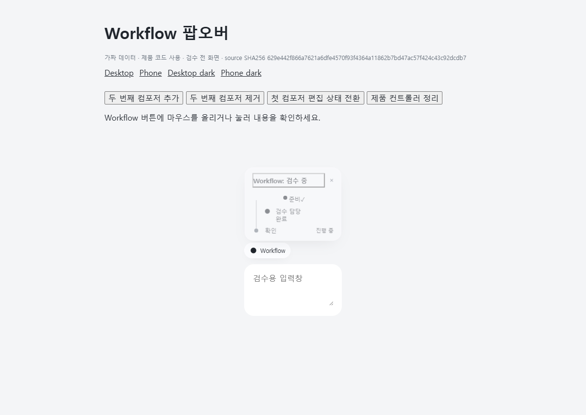
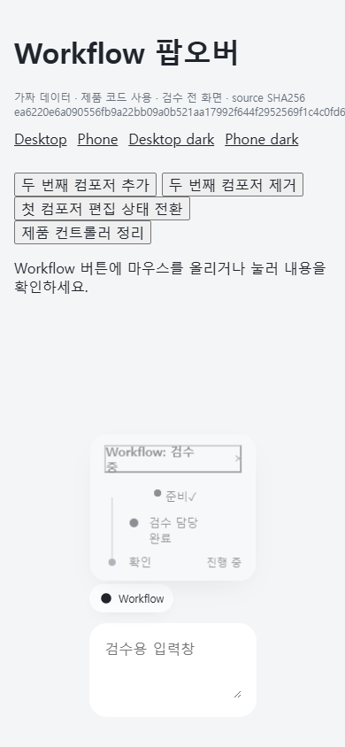
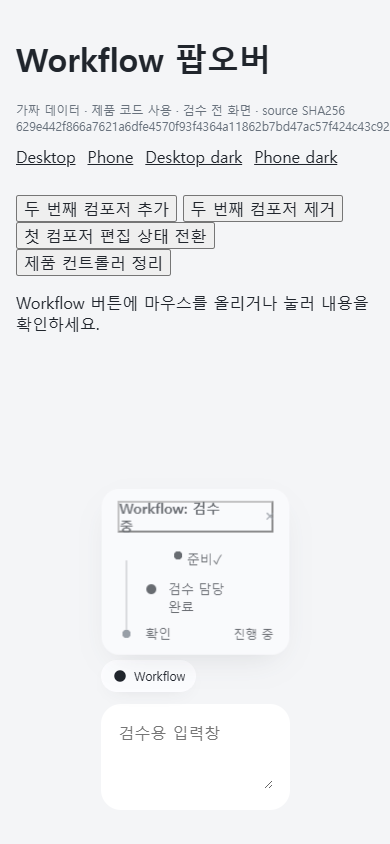

# 채팅 전환 지연 반감 연구

2026-10-29 중간 기록이다. **기능을 보존한 제품 후보의 목표 달성은 아직 확인하지 않았다.** 이 문서는 실행한 실험과 실패를 보존하며 연구가 끝날 때 판정을 갱신한다.

## 사용자가 얻으려는 변화

채팅을 바꿀 때 Chat UI가 더하는 지연을 현재의 절반 이하로 줄이는 것이 목표다. 프로스트 외형과 기존 입력·정보 표시 동작을 유지한다. 자체 컴포저는 별도 구조 대안이며, 교체 가능성과 성능 향상은 다른 주장으로 다룬다.

연구 시작 조건으로 agentation을 실제 비활성화했다. 모든 새 측정은 이 조건의 새 브라우저에서 실행했다. 메인 체크아웃과 설치된 Chat UI는 원본을 유지한다. 후보는 별도 소스 사본에서 빌드하고 해당 브라우저 context의 자산 응답만 대체한다.

Codex 주간 사용률 감시 스크립트는 별도 프로세스로 실행한다. 80% 이상을 관찰하면 새 실험을 허용하지 않고, 부모를 제외한 Codex 후손의 중단 요청을 시작한다. 부모는 결과 보고와 PR 작성만 계속한다. 사용률은 계정의 주간 한도 비율이며 토큰 개수 자체가 아니다. 원시 계정 응답과 로컬 상태는 저장소에 넣지 않는다.

## 기준과 재현 범위

### 시작 시점과 BB의 변화

확인 가능한 Git ref의 최초 커밋은 2026-10-03 15:32:18 KST의 [`0b718ef`](https://github.com/MORPHLET/bb-chat-ui/commit/0b718ef153a052b9340b880dc2654fc92edd197e)이며 빈 등록 골격이었다. 최초 실제 화면은 같은 날 16:11:46 KST의 [`fdf5fea`](https://github.com/MORPHLET/bb-chat-ui/commit/fdf5fea1748c9b0b3b8d734d41da9b7ae46f1208)에서 변경 요약 pill과 Diff 열기를 추가했다. 당시 package의 BB `>=0.44`는 최소 호환 조건이다. 시작 당시 실제 설치판은 확인하지 못했다. 당시 이미 공개된 안정판은 [0.45.0](https://github.com/get-bb/bb/releases/tag/desktop-v0.45.0)이었다. 현재 CLI와 서버의 0.48.0은 별도로 확인했으며 공식 비교 근거는 [0.48.0 릴리스](https://github.com/get-bb/bb/releases/tag/desktop-v0.48.0)와 그 태그의 [고정 CHANGELOG](https://github.com/get-bb/bb/blob/1a4a1d254c7b1f70d340ef9c800dad77dbeb8e66/CHANGELOG.md)다.

공식 기록상 0.46은 메시지 링크, 승인 표시, 큐 편집 보호, Info 개편과 상세 지연 로드를 추가했다. 0.46.1은 모바일 큐와 스크롤 보정 및 code-fence renderer를 다뤘다. 0.47은 메시지 편집과 읽기 위치, 모바일 패널 swipe, 통합 탭 계약을 확장했다. 0.48은 하단 고정과 큐 순서, 열린 패널 우선 로드, 변경분 전송과 패널 너비 기억을 다뤘다. 이는 공개된 동작과 개선 발표이며 이번 머신의 속도 측정 결과는 아니다. 메시지 액션과 실험적 timeline windowing은 시작 전에도 있었으므로 0.48의 신기능으로 계산하지 않는다.

### 유지·단순화·대체의 경계

호스트는 메시지 렌더링·편집·첨부·스크롤·큐·승인과 탭 수명을 관리한다. Chat UI는 frost, compact 인용, 정보 pill·상세 카드, 목차 미리보기, phone 시트와 모션을 추가한다. 이 제품 동작은 유지하고 불필요한 전역 처리부터 줄인다. 본문·코드·표와 첨부의 표면은 스타일 단순화 후보이며, 공개 메시지 액션은 새 액션을 추가할 때 우선 검토할 수 있다. 다만 메시지 전체 교체 계약은 아니다. [공식 SDK 계약](https://github.com/get-bb/bb/blob/1a4a1d254c7b1f70d340ef9c800dad77dbeb8e66/packages/plugin-sdk/src/app-contract.ts)과 [ThreadChat 공개 진입점](https://github.com/get-bb/bb/blob/1a4a1d254c7b1f70d340ef9c800dad77dbeb8e66/packages/plugin-sdk/src/app.ts)을 기준으로 범위를 구분했다.

설치 목록에서 inline-vis·genui는 메시지 시각화, image-preview는 이미지 미리보기, message-date-time은 시각 표시를 제공한다. Drafts·예약 전송·Secrets·질문 기능은 호스트가 제공하는 동작과 연결된다. panel-tabs와 호스트의 탭 관리도 겹치는 영역이다. 목록의 활성 상태만으로 실제 표시나 중복 비용을 입증하지 않는다. 시각화 iframe을 숨기는 것만으로 내부 실행이 멈춘다는 보장도 없다.

Git과 PR은 각각 [번들 Git](https://github.com/get-bb/bb/blob/1a4a1d254c7b1f70d340ef9c800dad77dbeb8e66/plugins/git/app.tsx)과 [GitHub PR Status](https://github.com/get-bb/bb/blob/1a4a1d254c7b1f70d340ef9c800dad77dbeb8e66/plugins/github-pr-status/store.ts)가 제공한다. PR 서버에는 캐시와 진행 중 요청 공유가 있어 중복 RPC 감소를 같은 비율의 서버 작업 감소로 계산하지 않는다. 자식 목록과 Git 조회의 생략은 공개 이벤트에 충분한 변경 정보가 없어 보류했다. 통합 패널 API는 [호출 플러그인의 소유권을 검사](https://github.com/get-bb/bb/blob/1a4a1d254c7b1f70d340ef9c800dad77dbeb8e66/apps/app/src/lib/plugin-panel-controller.ts)하므로 다른 플러그인의 Diff 탭을 공개 API로 직접 열 수 있다고 가정하지 않는다.

### 이번 실험 환경

제품 소스는 `50ba38154180331583eca024aaac0612a1d85a50`, CLI·서버는 BB 0.48.0이다. Windows의 Chrome 156.0.8078.48 headless에서 실제 사이드바로 두 완료 연구 스레드를 왕복한다. desktop device,1100×750,새 context,고정 warmup과 순서를 사용한다. 사용자 메시지·초안·설정·탭 상태를 쓰지 않는다. 탭 갱신은 context별 메모리 overlay로 처리하며 실제 서버의 시작·종료 snapshot 일치를 확인한다. 이 overlay는 서버 DB 지연과 broadcast를 재현하지 않는다.

원본 JavaScript SHA-256은 `b48976d46ee1a4e481be935db567b0353f93d7e8e54fa05d9bb51f2d663dbc04`다. 원본 CSS는 `bf26fb81381afa72c8c516b2c44b7b34153a66cbf8520a3b211d73ca4277e15d`다. BB는 이미 호스트가 제공하는 Tailwind 항목을 제외한 CSS를 브라우저에 전달한다. 이 환경의 전달 CSS는 `0af2fca3bf63d1bf2836bebdb65c29665be6bc7b8e6f0c13eb2b260a4253fa17`다. 검사는 원본 해시 고정과 같은 요청의 직접 서버 응답·브라우저 응답 바이트 일치를 각각 확인한다.

일차 지표는 실제 클릭 캡처부터 대상 스레드의 고유 행을 DOM에서 찾고 표시·viewport 교차·hit-test를 확인한 시점까지다. 60ms polling과 자동화 작업이 포함된다. **실제 paint, INP 또는 입력 반응 완료 시간을 직접 재지 않았다.** 이후의 focus 확인은 별도 관측이다. Electron 사용자 창, 실물 phone, 실제 IME·voice, 사용자의 시각 판정도 아직 확인하지 않았다.

A1/A2는 같은 원본을 새 context에서 각각 실행한다. N은 JS entry만 no-op으로 바꾸고 metadata와 CSS URL을 남긴다. URL 존재와 실제 stylesheet 적용은 구분한다. F는 해당 context의 plugin 목록에서 Chat UI 항목만 제외해 JS·CSS와 표시 기여를 로드하지 않는다. F도 backend는 유지하므로 전체 플러그인을 전역 비활성화한 조건이나 모든 native BB 사용을 뜻하지 않는다.

## 완료한 기준선 탐색

독립 Chrome 실행 4개 안에서 각각 A1/A2/N/F를 순차 실행했다. 각 context는 warmup 2회 뒤 관측 6회를 수행했다. 16개 context가 자산·metadata·대상 행·focus·오류·overlay 검사를 통과했다. agentation의 자산·toolbar·freeze hook과 rAF 변경은 없었고, Chrome을 모두 종료했으며 서버 탭 상태는 전후 일치했다.

각 블록의 원본 두 중앙값 평균에서 F 중앙값을 뺀 차이는 428.5,248.9,272.8,250.1ms였다. 같은 코드 A1−A2도 238.7,49.3,65.5,−13.4ms 차이를 보였다. 후자를 무시하고 전환 관측 96개를 독립 표본으로 세지 않는다. 값은 [정리된 관측 자료](chat-switch-discovery.json)에 보존했다. 독립 검토자는 원시 시각에서 요약을 재계산했다. 후보는 이 단계에서 측정하지 않았다.

첫 기준 실행은 CSS 해시 gate에서 중단했다. 브라우저 전달 CSS 변환을 검증하지 않은 검사 오류였다. 해당 실패는 보존하고, 고정 BB 소스의 변환 경로와 같은 요청의 바이트 관계를 확인한 뒤 별도 run-02로 전체를 실행했다. 실패 값을 원본 허용 목록에 단순 추가하지 않았다.

## 원인 분리와 다음 후보

정보 표시와 프로스트 각각에 대해 controller 없이 스타일만 유지하거나 스타일 없이 controller만 유지하는 네 변형을 빌드했다. 외부 app.css는 원본과 같았다. 원본과 F를 포함한 6조건을 독립 Chrome 블록 3개,18개 context에서 비교했다. 모든 검사와 독립 재계산을 통과했다.

정보 controller만 유지하고 해당 주입 스타일을 제외한 조건은 원본보다 세 블록 모두 낮았다. 원본 중앙값은 530.1/535.2/486.9ms, 해당 조건은 315.4/335.4/369.7ms였다. 그러나 외형·배치·스타일 일치 여부가 달라졌으므로 이 차이는 순수 CSS 비용이나 출하 가능한 개선량이 아니다.

다음 진단 H는 Workflow의 agent 행 규칙 네 개와 CircleCheck 조건 두 가지만 제외했다. 세 블록의 원본/H/F 중앙값은 각각 533.5/373.6/264.3ms, 510.3/346.8/228.4ms, 544.8/411.3/223.6ms였다. H는 원본보다 159.9/163.5/133.5ms 낮았다. 모든 context 검증과 독립 재계산이 통과했다. 그러나 측정 전후에는 Workflow trigger가 없었고, 중간 상태까지 증명한 것은 아니다. 열린 화면을 바꿀 수 있는 기능 제거 진단이므로 이 수치를 제품 후보의 개선량이나 순수 선택자 비용으로 사용하지 않는다.

인용 pill의 별도 후보는 같은 MutationObserver 콜백에서 추가되는 인용의 위치 계산을 동기로 모은다. 가짜 데이터의 비점수 브라우저 검증에서 기존 인용 1개와 새 인용 3개는 좌표 읽기가9회에서4회로 줄었다. 첫·후속 크기 변경 후 위치와 콜백 반환 전 위치를 확인했다. ResizeObserver는 유지한다. 이 결과는 실제 전환의 사용 빈도나 시간 효과를 증명하지 않는다. 첫 진단의 RO 검사 실패와 기존 M2 효과 기준 미충족도 유지한다.

## 외형을 보존하는 C1 후보

검증한 후보 커밋은 `d9af383ab2f571a926e02a22204a0c02c3fc1fa5`다. 닫힌 Workflow 상세 카드에만 필요한 연속 스타일 구간을 분리하고, 첫 열기에서 표시와 위치 측정 전에 연결한다. 여러 카드가 열리면 마지막 카드가 닫힐 때 분리한다. 편집 중 닫기가 거부되면 연결을 유지한다. 공통 카드 규격과 인용 스타일은 계속 연결한다. 열린 상태의 전체 정보 CSS 텍스트는 원본과 바이트 단위로 같고 적용 순서를 보존한다. 이는 H의 단순 삭제보다 기능을 보존하려는 후보이며 효과는 별도로 측정해야 한다.

후보의 focused 검사, 타입 검사, 빌드와 전체 테스트 694개가 통과했다. 최초 전체 실행은 기존 검수 helper가 분리된 스타일의 뒷부분을 읽지 못해 실패했다. 연결된 정보 스타일을 DOM 순서대로 읽도록 helper를 고쳤고 기존 검증 조건은 유지했다. 별도 사본에서 마지막 카드 소유자 판정을 반대로 바꾼 변이는 다중 카드 검사에서 실패했다.

독립 데모 QA는 기준·후보 각각 desktop/phone 모사와 light/dark의 총 8개 context를 검사했다. 열기·닫기·다중 카드·편집 중 닫기 거부·정리, 활성 CSSOM 규칙과 순서, 첫 표본 프레임이 일치했다. 입장 모션 중 서로 다른 시점에 비교한 앞선 프레임 검사는 실패했다. 그 기록을 보존하고 모션 완료 후 같은 동작을 시작하는 조건에서 기존 2px 경계를 유지해 다시 검사했다. 첫 표본 프레임은 첫 paint와 다르다. 데모는 같은 제품 TS 소스 사본을 변환해 가짜 데이터를 주입했으며 설치된 app.js 실행이나 실제 BB 통합을 증명하지 않는다. 캡처는 desktop·phone 모사에 있고 실물 phone 캡처는 없다. 화면의 최종 판정은 사용자에게 남는다.

실제 BB의 비점수 사전 검사에서는 원본과 후보에 보이는 대화 행이 두 대상에서 각각 5개와 3개로 일치했다. 정규화한 정보 데이터, 모델·환경 표시, 새 context의 초안·첨부 비교도 일치했다. 비교 내용은 메모리에서만 처리하고 원문과 내용 해시는 보존하지 않았다. Agentation 비활성, 자산·CSS·서버 상태 검사와 종료 확인도 통과했다. 이는 표시된 일부 행과 새 context의 상태에 한정된다. 화면 밖 행, 실제 사용자 창의 초안, 전체 렌더러 입력 또는 서버 GET의 직접 소비는 증명하지 않는다. 이 검사에는 읽기 전용 계측 번들을 썼으며 시간 측정에는 무수정 제품 번들을 사용한다.

사전 검사의 첫 실행은 프로토콜에 복사한 CSS 해시 두 개가 각각 65자라서 중단됐다. 실패를 보존하고 원본과 QA JSON에서 정상 64자 값을 기계적으로 가져오도록 고쳤다. 해시 형식, QA·커밋·실제로 전달할 번들 사이의 연결도 검사한다. 두 번째 실행이 통과했으며 첫 실행을 통과로 변경하지 않았다. 스타일의 첫 연결 비용이 첫 열기에 옮겨갈 가능성도 별도 검증 대상으로 남는다.

### C1의 전환 탐색 결과

무수정 원본·후보 번들과 F를 세 독립 Chrome 실행에서 비교했다. O/F/C, F/C/O, C/O/F 순서를 미리 고정했고 context마다 warmup 2회와 관측 6회를 실행했다. 입력 수집은 warmup 직후에만 했으며 관측 여섯 회 사이에는 넣지 않았다. 아홉 context가 모든 유효성 검사를 통과했고, 서버 상태 일치와 Chrome·실행기 종료를 확인했다. 독립 검토자도 원시 시각에서 중앙값과 차이를 재계산했다.

| 블록 | 원본 O | 후보 C1 | 프런트엔드 제외 F |
|---|---:|---:|---:|
| 1 | 504.9ms | 388.0ms | 237.3ms |
| 2 | 499.1ms | 403.0ms | 256.5ms |
| 3 | 461.0ms | 401.7ms | 225.5ms |

C1의 관측 중앙값은 원본보다 116.9/96.1/59.3ms 낮았다. 그러나 세 블록 모두 동시대 `(O+F)/2`보다 높았다. 따라서 C1 단독으로 미사용 8블록 최종 확인을 시작하지 않는다. 이는 기능 동작을 보존한 작은 후보의 탐색 결과이며, 세 블록만으로 효과의 신뢰구간이나 채택·반감 성공을 판정하지 않는다. 다음은 C1을 기준으로 정보 카드와 인용 미리보기의 native typography fallback을 각각 분리하는 진단이다. 글자 스타일을 제거하는 조건은 제품 후보로 채택하지 않는다.

### 카드 글자 스타일 진단

C1 기준에서 D-info는 정보 카드 삽입 지점만, D-quote는 인용 미리보기 삽입 지점만 바꿨다. 각 변형은 native typography의 규칙 12개와 `p` 분기 하나를 제외하고 직접 prose 슬롯·공통 변수·frost·button/a·다른 삽입 지점의 바이트를 유지했다. 생성 CSS는 독립 예상 생성물과 파서로 대조했다. Workflow의 원래 생성 바이트는 유지되지만 진단의 열린 Workflow 화면은 검사하지 않았다.

| 블록 | 기준 C1 | D-info | D-quote |
|---|---:|---:|---:|
| 1 | 376.5ms | 342.8ms | 395.7ms |
| 2 | 449.4ms | 416.4ms | 371.5ms |
| 3 | 388.9ms | 398.6ms | 355.6ms |

9개 context의 입력·스타일·자산·Agentation·서버·사용량 검사는 통과했다. 독립 재계산도 일치했다. 두 변형 모두 C1과의 차이가 세 블록에서 같은 방향을 보이지 않았다. 따라서 이 결과만으로 조건부 글자 스타일 연결 같은 제품 변경을 만들지 않는다. 이 결과는 비용이 없다는 증명이 아니며, 제거된 외형과 다른 stylesheet의 상호작용도 포함한다. 다음 반증은 남은 SOURCE 부재 선택자와 컴포저의 제거 노드 정리 경로를 각각 분리한다.

검수용 가짜 데이터 캡처를 함께 보관한다. [캡처 출처와 해시](images/provenance.json)를 기준으로 비교할 수 있다. 이 캡처는 실제 BB 화면이나 설치된 번들의 실행 화면이 아니다.

| 모드 | 기준 | 후보 |
|---|---|---|
| Desktop 모사·light |  |  |
| Phone 모사·light |  |  |

## 제품 후보의 판정 원칙

### 앞선 실험의 실패를 유지한다

| 경로 | 실패한 조건 | 의미와 남은 가치 |
|---|---|---|
| TOC 포인터 처리 | 동일 코드 A/A의 ±5ms 경계 실패. 별도 큰 효과 탐색도 50ms 초과와 30% 초과 조건 미충족 | 축약 화면 CPU 감소 관찰을 실제 채팅 전환 개선으로 채택하지 않았다. |
| R1 스크롤 대상 탐색 | A/A 95% 구간 −0.338~+0.626ms가 ±0.5ms 안에 들지 못함 | 작은 효과를 구별하는 준비가 부족했다. 후보가 느리다는 판정이 아니다. |
| M1 입력 중 인용 검색 | A/A 95% 구간 −1.955~+1.017ms가 ±1ms 안에 들지 못함 | 실제 EditorView를 확보하지 못한 모사 실험이며 실제 사용 빈도도 미확인이다. |
| M2 인용 20개 초기 등록 | layout/style 지표 구간 −0.716~+0.317ms, TaskDuration 구간 −1.727~+0.810ms가 각각 ±0.5/±1ms 경계를 벗어남 | 1개 조건은 통과했다. 20개 조건의 A/A는 후보 효과를 측정한 결과가 아니다. |
| 인용 동기 일괄 등록 후속 | 첫 브라우저 진단에서 기준의 RO 완료 전 위치 검사 중단 | 실제 측정 콜백 완료를 기다리는 별도 진단은 통과했다. 읽기 9→4는 확인했으나 전환 효과는 미확인이다. |
| C1 데모와 사전 검사 | CSSOM 분류 오류, favicon 404, 입장 모션 중 서로 다른 시점 비교, 잘못 복사한 해시 | 제품 오류와 검사 오류를 분리했다. 원본 실패는 보존하고 원인을 고친 별도 실행만 새 근거로 쓴다. |

초기 M2의 설치 구간 wall time만 재는 안은 후속 작업을 빼먹을 수 있어 철회했다. 고정 관찰 구간으로 바꿀 때도 등록 시작 뒤 500ms 전체가 포함되는지 확인했다. 이와 같은 측정 경계 수정은 이미 수집한 실패를 합격으로 바꾸는 근거가 아니다. 작은 fixture의 A/A 실패가 반복됐으므로 현재 연구는 실제 채팅 전환에 영향을 주는 전역 스타일로 초점을 옮겼다. 기존 후보는 새로운 실사용 빈도와 비용 근거가 생기면 다시 조사할 수 있다.

과거 한 블록의 진단값835.6ms와331.0ms에서 나온 절대 중간값583.3ms를 남긴다. 과거 실험은 프런트엔드 응답 대체였으므로 이번 실제 agentation 비활성 조건과 동일한 조작으로 부르지 않는다. 과거 절대값만 낮아졌다고 목표를 달성한 것으로 처리하지 않는다.

후보 C는 별도의 동시대 원본 A와 F를 함께 측정해야 한다. 초안은8개 독립 Chrome 블록에서 context 중앙값을 구하고,블록별 `D=C−(A+F)/2`와 `G=A−F`를 분석한다. D 평균의 단측97.5% t 상한이0이하이고 G 평균의 단측97.5% 하한이0보다 클 때만 공동95% 기준의 반감 근거로 다룬다. 이는 블록 독립성과 정규성 가정에 조건부이며 같은 머신의 시간 상관이 남는다. 불확실하면 미확정으로 기록한다. 후보 코드와 수치 기준은 확인 실행 전에 고정하고 중간 값을 보고 표본 수를 늘리거나 문턱을 바꾸지 않는다.

기능 제거 변형은 채택하지 않는다. 제품 후보는 원본 frost,정보 표시 시점·접힘·팝오버,동적 변경,빠른 전환,키보드·초점,여러 컴포저와 정리를 별도 검증해야 한다. 정보 표시를 뒤로 미뤄 DOM proxy만 낮추지 않았는지도 확인한다. 제품 테스트·타입 검사와 같은 제품 코드의 desktop·phone 검수 데모가 필요하며 사용자의 화면 판정은 별도다.

## 자체 컴포저와 자동 반복 도구

BB 0.48의 [experimental_composer 공식 계약](https://github.com/get-bb/bb/blob/1a4a1d254c7b1f70d340ef9c800dad77dbeb8e66/packages/plugin-sdk/src/app-contract.ts#L2469-L2500)은 입력 상자 전체 교체를 허용한다. [기본 컴포저](https://github.com/get-bb/bb/blob/1a4a1d254c7b1f70d340ef9c800dad77dbeb8e66/plugins/composer/app.tsx)도 같은 슬롯을 쓴다. 초안·전송·업로드와 일부 컨트롤은 재사용할 수 있지만 기존 편집기만 공개 API로 가져와 외곽을 교체하는 경로는 확인하지 못했다. 자체 컴포저는 편집기·IME·메뉴·음성 전달과 공개 adapter를 책임져야 한다. Apple과 비슷한 웹 외형과 모션은 별도 구현할 수 있으나, 웹 슬롯이 임의의 UIKit·SwiftUI 구성요소를 주입하는 계약은 확인되지 않았다. 성능을 측정하지 않은 구조 대안이다.

현재는 수동으로 소수 후보를 통제한다. 아래 세 도구는 서로 다른 저장소의 고정 소스로 비교했다. 설치하거나 실행하지 않았다.

| 경로 | 확인한 기능 | 이 연구에서의 판단 |
|---|---|---|
| 수동 | 원인 분리, 단일 후보, 직렬 브라우저와 별도 검토 | 현재 사용한다. 실제 UI와 계측 오류를 함께 확인하기 쉽다. |
| [bb-autoresearch](https://github.com/pascal-de-ladurantaye/bb-autoresearch/blob/836fa3446dbd0ab96df8a864ffa52a4638ac8a35/README.md) | worktree 작업자, 호스트별 A/A·MDE 보정, 예산, 후보 ref, 선택적 holdout | 브라우저 benchmark가 안정된 뒤 소수 후보의 제한된 탐색에 적합한 후보이다. Windows 실사용은 미검증이다. |
| [autoresearch-self-loop](https://github.com/zom-2018/bb-plugin-autoresearch-self-loop/blob/7186fb1a2f5e7d24c7a0ec766608ef3976569949/README.md) | 한 checkout의 실행·기록·자동 재개 | [keep 검사](https://github.com/zom-2018/bb-plugin-autoresearch-self-loop/blob/7186fb1a2f5e7d24c7a0ec766608ef3976569949/lib/loop.ts)가 새 run을 항상 요구하지 않고 폐기는 Git을 바꿀 수 있다. 공유 checkout의 첫 도입에는 권하지 않는다. 요청한 이름과 일치하는 이 소유자를 대상으로 했다는 식별 한계가 있다. |
| [TheGreenCedar codex-autoresearch](https://github.com/TheGreenCedar/codex-autoresearch/blob/fbc07c5f8ea41cd756e59812d71b5b9948179dc6/README.md) | 목표·지표·수정 범위·잡음·예산 계약과 반복 기록 | 단일 Codex 중심의 대안이다. [runner](https://github.com/TheGreenCedar/codex-autoresearch/blob/fbc07c5f8ea41cd756e59812d71b5b9948179dc6/plugins/codex-autoresearch/lib/runner.ts)에 Windows 처리는 있으나 전체 통합은 미검증이다. |

bb-autoresearch의 [보정](https://github.com/pascal-de-ladurantaye/bb-autoresearch/blob/836fa3446dbd0ab96df8a864ffa52a4638ac8a35/src/calibration.ts)과 [잡음](https://github.com/pascal-de-ladurantaye/bb-autoresearch/blob/836fa3446dbd0ab96df8a864ffa52a4638ac8a35/src/noise.ts), [holdout](https://github.com/pascal-de-ladurantaye/bb-autoresearch/blob/836fa3446dbd0ab96df8a864ffa52a4638ac8a35/src/holdout.ts)은 유용하지만 데이터의 대표성과 평가자 격리를 자동 보장하지 않는다. 세 도구 모두 완성된 bb-chat-ui 브라우저 benchmark를 대신하지 않는다. 한 명령의 고정 workload, 같은 코드 A/A, 기능·회귀 oracle, 외부 수정이 차단된 판정과 미사용 확인 자료가 먼저 필요하다. 이번처럼 측정계와 화면 조건이 계속 보완되는 단계에서는 자동 후보 반복을 시작하지 않는다. 외형·모션·자체 컴포저는 제품 아이디어이며 자동 성능 점수로 채택하지 않는다.
